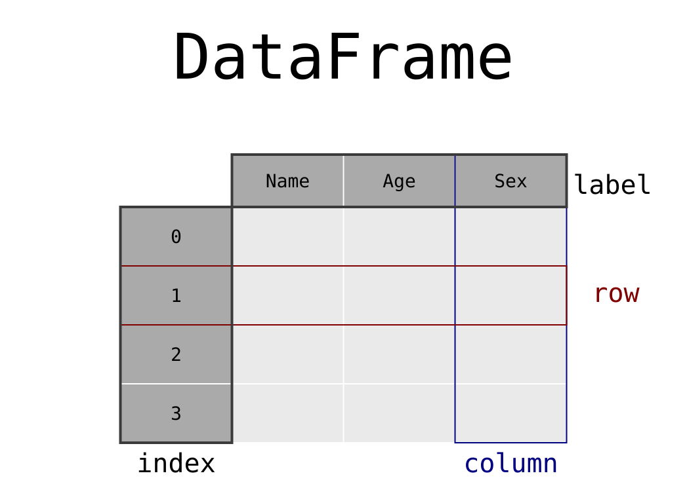
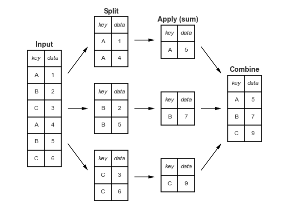

```{python}
#| label: setup
#| include: false
import numpy as np
import pandas as pd
import matplotlib.pyplot as plt
import seaborn as sns

rng = np.random.default_rng(42)
sns.set_theme(style="whitegrid", context="talk")
pd.set_option("display.max_columns", 12)
pd.set_option("display.width", 120)
```

# Data Analytics Foundations

## Learning objectives

By the end of the module, students will be able to:

- inspect the structure and data types of a DataFrame;
- select, filter, and reorder rows and columns;
- create variables using vectorized operations;
- build readable transformation pipelines;
- distinguish aggregation from transformation;
- control indexes created by grouping operations;
- prepare analysis-ready data for visualization.

::: {.notes}
Relacione cada objetivo a uma entrega observável. Enfatize que visualização confiável começa com transformação confiável. Tempo: 2 min.
:::

## Why transform data?

> Data rarely arrive in exactly the form required for analysis.

A typical analytical workflow requires us to:

1. select relevant observations;
2. diagnose types and missing values;
3. construct meaningful variables;
4. define the analytical granularity;
5. summarize or normalize within groups;
6. produce a visualization-ready table.

::: {.notes}
Explique que transformar não significa distorcer. Significa reorganizar a mesma informação para responder a uma pergunta analítica específica.
:::

## Getting started with pandas

{fig-alt="A DataFrame with an index, columns, and values" width="80%"}

::: {.notes}
The most basic pandas object is DataFrame. A DataFrame is a two-dimensional data structure that stores different data types in columns. It contains rows, columns, values, an index, and column names.
:::

## DataFrame

```{python}
df = pd.DataFrame(
    data={
        "col0": [0, 0, 0, 0],
        "col1": [0, 0, 0, 0],
        "col2": [0, 0, 0, 0],
        "col3": ["a", "b", "b", "a"],
        "col4": ["alpha", "gamma", "gamma", "gamma"],
    },
    index=["row" + str(i) for i in range(4)],
)
df.head()
```

::: {.notes}
Há cinco colunas e quatro entradas no índice. Destaque que o índice não é uma coluna comum, embora possa carregar informação sobre a identidade das observações.

Mostre que compreender o índice e ler pipelines encadeados são duas habilidades fundamentais para trabalhar com pandas.

### The index

- identifies or organizes rows;
- may be preserved after filtering;
- changes after many group operations;
- can have multiple levels.

### Method chaining

- connects transformations sequentially;
- makes analytical logic visible;
- reduces intermediate objects;
- supports reproducible pipelines.
:::

## Flights data

```{python}
url = "https://raw.githubusercontent.com/byuidatascience/data4python4ds/master/data-raw/flights/flights.csv"
flights = pd.read_csv(url)
flights.head()
```

::: {.notes}
A base contém voos que partiram de Nova York em 2013. Observe os nomes, valores e granularidade: cada linha representa um voo com uma origem, destino, entre outras informações.
:::

## Inspecting structure

:::: {.columns}

::: {.column width="50%"}

```{python}
flights.shape
```

```{python}
flights.info()
```

:::

::: {.column width="50%"}

```{python}
flights.dtypes.head()
```

```{python}
flights.isna().sum().sort_values(ascending=False).head()
```

:::

::::


::: {.notes}
Antes de analisar: confirme dimensão, tipos, valores ausentes, unidade de observação e possíveis chaves. Essa etapa protege todas as análises posteriores.
:::

::: {.notes}
Use info() para verificar o número de linhas, colunas, valores não nulos, tipos e memória. Faça os alunos identificarem quais variáveis possuem valores ausentes.
:::

## Data types determine valid operations

| dtype | Analytical meaning | Typical operations |
|---|---|---|
| `int64` | integers | arithmetic, counts |
| `float64` | real numbers | arithmetic, statistics |
| `bool` | logical values | filters, flags |
| `string` | text | matching, cleaning |
| `category` | repeated labels | grouping, ordering |
| `datetime64` | date and time | lags, intervals, resampling |
| `object` | generic or unresolved | inspect and convert |

::: {.notes}
Uma coluna com aparência de data pode ainda estar armazenada como object. O tipo determina quais operações são válidas.
:::

## Converting date and time

```{python}
flights["time_hour"].head()
```

```{python}
flights["time_hour"] = pd.to_datetime(
    flights["time_hour"],
    format="%Y-%m-%dT%H:%M:%SZ"
)
flights["time_hour"].head()
```

::: {.notes}
Compare o dtype antes e depois. A conversão explícita documenta o formato esperado e permite operações temporais posteriores.
:::

# Manipulating Rows

## A compact example DataFrame

```{python}
demo = pd.DataFrame(
    data=np.reshape(range(36), (6, 6)),
    index=["a", "b", "c", "d", "e", "f"],
    columns=["col" + str(i) for i in range(6)],
    dtype=float,
)
demo["col6"] = ["apple", "orange", "pineapple", "mango", "kiwi", "lemon"]
demo
```

::: {.notes}
Use esta tabela pequena para separar claramente seleção por rótulo, seleção por posição e filtragem por condição.
:::

## Accessing rows by label: `.loc`

```{python}
demo.loc[["a", "b"]]
```

General pattern:

```python
df.loc[row_labels, column_labels]
```

::: {.notes}
.loc trabalha com rótulos. A lista preserva o resultado como DataFrame, enquanto um único rótulo pode retornar uma Series.
:::

## Accessing rows by position: `.iloc`

```{python}
demo.iloc[0]
```

```{python}
demo.iloc[[0, 2]]
```

General pattern:

```python
df.iloc[row_positions, column_positions]
```

::: {.notes}
.iloc trabalha com posições inteiras iniciadas em zero. Discuta por que posição e rótulo podem divergir após filtros.
:::

## Filtering rows with `query()`

```{python}
demo.query("col6 == 'kiwi' or col6 == 'pineapple'")
```

```{python}
demo.query("col0 > 6")
```

Supported comparisons include `>`, `>=`, `<`, `<=`, `==`, and `!=`.

::: {.notes}
query() permite expressar condições de forma próxima à linguagem analítica. Reforce que igualdade usa dois sinais de igual.
:::

## Combining conditions

```{python}
flights.query("month == 1 and day == 1").head()
```

Equivalent Boolean indexing:

```{python}
flights[(flights["month"] == 1) & (flights["day"] == 1)].head()
```

::: {.notes}
As duas formas são válidas. query() costuma ser legível; indexação booleana é útil quando as condições são construídas programaticamente.
:::

## Reordering rows

```{python}
flights.sort_values(
    ["year", "month", "day", "dep_time"]
).head()
```

```{python}
flights.sort_values(
    "dep_delay",
    ascending=False
).head()
```

::: {.notes}
Com várias colunas, cada coluna posterior resolve empates nas anteriores. Mostre também que valores ausentes aparecem no final por padrão.
:::

## Combining row operations

```{python}
(
    flights
    .query("dep_delay <= 10 and dep_delay >= -10")
    .sort_values("arr_delay", ascending=False)
    .iloc[[0, 1, 2]]
)
```

::: {.notes}
Leia o código de cima para baixo: filtre voos que saíram aproximadamente no horário, ordene pelo atraso de chegada e selecione os três maiores casos.
:::

## Why operation order matters

```{python}
# Filter first, then sort a smaller table
result_a = (
    flights
    .query("dest == 'IAH'")
    .sort_values("arr_delay", ascending=False)
)

# Sort everything, then filter
result_b = (
    flights
    .sort_values("arr_delay", ascending=False)
    .query("dest == 'IAH'")
)

result_a[["flight", "dest", "arr_delay"]].head().equals(
    result_b[["flight", "dest", "arr_delay"]].head()
)
```

::: {.notes}
Os resultados podem ser equivalentes, mas filtrar antes geralmente reduz o volume que precisa ser ordenado. Diferencie equivalência lógica de eficiência computacional.
:::

# Manipulating Columns

## Creating new columns

```{python}
demo["new_column0"] = 5
demo.head()
```

```{python}
demo["new_column0"] = [0, 1, 2, 3, 4, 5]
demo.head()
```

::: {.notes}
Uma atribuição para um nome existente substitui a coluna. Uma sequência atribuída diretamente precisa ser compatível com o número de linhas.
:::

## Variables derived from existing columns

```{python}
demo["new_column3"] = demo["col0"] - demo["new_column0"]
demo[["col0", "new_column0", "new_column3"]]
```

Vectorized operations apply to complete columns rather than explicit row-by-row loops.

::: {.notes}
Operações vetorizadas são centrais em pandas. Elas costumam ser mais claras e eficientes do que loops explícitos.
:::

## Creating variables inside a pipeline

```{python}
flights_enriched = (
    flights.assign(
        gain=lambda df_: df_["dep_delay"] - df_["arr_delay"],
        speed=lambda df_: df_["distance"] / df_["air_time"] * 60,
    )
)

flights_enriched[["dep_delay", "arr_delay", "gain", "speed"]].head()
```

::: {.notes}
O argumento da lambda representa o DataFrame inteiro, não uma linha individual. gain mede quanto atraso foi recuperado ou perdido; speed converte distância por minuto em distância por hora.
:::

## Selecting columns

```{python}
demo["col0"].head()
```

```{python}
demo[["col0", "new_column0", "col2"]].head()
```

- single brackets with one name usually return a `Series`;
- a list of names returns a `DataFrame`.

::: {.notes}
Explique por que aparecem dois pares de colchetes: um acessa o DataFrame e o outro representa a lista de colunas.
:::

## Selecting rows and columns together

```{python}
demo.loc[
    ["a", "b"],
    ["col0", "new_column0", "col2"]
]
```

```{python}
demo.iloc[:, [0, 1]].head()
```

::: {.notes}
Os dois eixos são especificados no mesmo indexador. Dois pontos significam todas as linhas ou todas as colunas naquele eixo.
:::

## Selecting columns by type

```{python}
flights.select_dtypes(include="int").head()
```

```{python}
flights.select_dtypes(include="number").columns.tolist()
```

::: {.notes}
Seleção por tipo é útil para estatísticas, validação e modelagem. number inclui tanto inteiros quanto números de ponto flutuante.
:::

## Selecting columns by name pattern

```{python}
demo.loc[:, demo.columns.str.startswith("new")].head()
```

Other useful string methods include:

```python
.str.endswith()
.str.contains()
.str.isnumeric()
.str.islower()
```

::: {.notes}
Esse padrão é útil quando um schema usa prefixos consistentes, por exemplo price_, curve_, contract_ ou is_.
:::

## Renaming columns

```{python}
demo.rename(
    columns={
        "col3": "letters",
        "col4": "names",
        "col6": "fruit",
    }
).head()
```

```{python}
clean_names = (
    demo.columns
    .str.strip()
    .str.lower()
    .str.replace(" ", "_", regex=False)
)
clean_names.tolist()
```

::: {.notes}
rename() retorna um novo objeto, a menos que o resultado seja atribuído. Padronizar nomes ajuda documentação, joins e manutenção do pipeline.
:::

## Reordering columns

```{python}
ordered_demo = demo[["col5", "col3", "col1", "col4", "col2", "col0", "col6"]]
ordered_demo.head()
```

```{python}
demo.reindex(columns=sorted(demo.columns)).head()
```

::: {.notes}
A seleção explícita oferece controle total, mas pode omitir colunas por engano. reindex é útil para ordenações sistemáticas.
:::

## Review: one addressing system

```python
# By label
df.loc[["row0", "row1"], ["col0", "col2"]]

# By position
df.iloc[[0, 1], [0, 2]]
```

Remember:

- `.loc` refers to labels;
- `.iloc` refers to positions;
- `:` means all entries along an axis.

::: {.notes}
Se os alunos lembrarem apenas dois padrões de seleção, devem lembrar loc para nomes e iloc para posições.
:::

# Grouping and Summarizing

## Split, apply, combine





::: {.notes}
Split divide a tabela em grupos. Apply calcula uma função dentro de cada grupo. Combine reúne os resultados em uma nova tabela.
:::

## Grouping and aggregating

```{python}
(
    flights
    .groupby("month")[["dep_delay"]]
    .mean()
)
```

The output has one row per month, so the analytical granularity has changed.

::: {.notes}
Antes havia uma linha por voo. Depois da agregação, existe uma linha por mês. Peça aos alunos para sempre declararem a granularidade do resultado.
:::

## Explicit aggregation with `.agg()`

```{python}
(
    flights
    .groupby("month")[["dep_delay"]]
    .agg("mean")
)
```

Common aggregations include:

`count`, `size`, `first`, `last`, `mean`, `median`, `min`, `max`, `std`, `var`, and `sum`.

::: {.notes}
agg() torna explícito que várias linhas serão reduzidas a estatísticas de grupo.
:::

## Named aggregation

```{python}
monthly_delay = (
    flights
    .groupby("month")
    .agg(
        mean_delay=("dep_delay", "mean"),
        count_flights=("dep_delay", "count"),
    )
)
monthly_delay
```

::: {.notes}
A sintaxe é nova_coluna igual a uma tupla com coluna original e função. Os nomes finais já ficam adequados para relatórios e gráficos.
:::

## `count()` versus `size()`

```{python}
(
    flights
    .groupby("month")
    .agg(
        non_missing_delays=("dep_delay", "count"),
        total_rows=("dep_delay", "size"),
        missing_delays=("dep_delay", lambda x: x.isna().sum()),
    )
)
```

::: {.notes}
count conta valores não nulos. size conta linhas. Essa diferença altera denominadores e deve ser validada antes de comunicar resultados.
:::

## Grouping by multiple variables

```{python}
month_year_delay = (
    flights
    .groupby(["month", "year"])
    .agg(
        mean_delay=("dep_delay", "mean"),
        count_flights=("dep_delay", "count"),
    )
)
month_year_delay
```

::: {.notes}
Agrupar por mais de uma variável cria um MultiIndex. O índice representa a combinação dos níveis de agrupamento.
:::

## Returning groups to columns

```{python}
month_year_delay.reset_index()
```

An alternative is to avoid grouped indexes:

```{python}
(
    flights
    .groupby(["month", "year"], as_index=False)
    .agg(
        mean_delay=("dep_delay", "mean"),
        count_flights=("dep_delay", "count"),
    )
)
```

::: {.notes}
reset_index() é comum antes de visualizar, exportar ou fazer joins. as_index=False produz diretamente uma tabela plana.
:::

## Aggregation versus transformation

::: {.columns}
::: {.column width="48%"}
### `.agg()`

- one result per group;
- reduces the number of rows;
- changes analytical granularity;
- useful for summary tables.
:::

::: {.column width="48%"}
### `.transform()`

- one result per original row;
- preserves the number of rows;
- aligns group statistics to observations;
- useful for normalization and benchmarks.
:::
:::

::: {.notes}
Esta é a distinção central da aula. agg responde qual é a estatística do grupo. transform responde como cada observação se compara à estatística do grupo.
:::

## Grouping and transforming

```{python}
flights_transformed = flights.copy()

flights_transformed["max_delay_month"] = (
    flights_transformed
    .groupby("month")["arr_delay"]
    .transform("max")
)

flights_transformed["delay_frac_of_max"] = (
    flights_transformed["arr_delay"]
    / flights_transformed["max_delay_month"]
)

flights_transformed[
    ["year", "month", "day", "arr_delay", "max_delay_month", "delay_frac_of_max"]
].head()
```

::: {.notes}
Todos os voos de um mesmo mês recebem o mesmo máximo mensal. A divisão subsequente compara cada voo com o caso extremo do respectivo mês.
:::

## The mathematics of transformation

For observation $i$ in group $g$:

$$
z_i = \frac{x_i}{\max_{j \in g}(x_j)}
$$

The group statistic is repeated and aligned with the original observations.

```{python}
len(flights_transformed) == len(flights)
```

::: {.notes}
transform preserva a cardinalidade e o alinhamento do índice. Essa propriedade permite atribuir o resultado diretamente como nova coluna.
:::

# From Transformation to Visualization

## Build a visualization-ready table

```{python}
monthly_viz = (
    flights
    .groupby("month", as_index=False)
    .agg(
        mean_departure_delay=("dep_delay", "mean"),
        median_departure_delay=("dep_delay", "median"),
        flights_observed=("dep_delay", "count"),
    )
    .sort_values("month")
)
monthly_viz
```

::: {.notes}
Uma tabela de visualização deve possuir granularidade explícita, nomes autoexplicativos e ordenação coerente.
:::

## Visualizing monthly delays

```{python}
#| fig-width: 11
#| fig-height: 5.6
fig, ax = plt.subplots()
sns.lineplot(
    data=monthly_viz,
    x="month",
    y="mean_departure_delay",
    marker="o",
    linewidth=2.5,
    ax=ax,
)
ax.set(
    title="Average departure delay by month",
    xlabel="Month",
    ylabel="Average departure delay (minutes)",
    xticks=range(1, 13),
)
sns.despine()
plt.show()
```

::: {.notes}
A linha é apropriada porque os meses possuem ordem temporal. O eixo deve comunicar unidade. Evite transformar uma média em narrativa causal.
:::

## Comparing center and sample size

```{python}
#| fig-width: 11
#| fig-height: 5.6
fig, axes = plt.subplots(1, 2, figsize=(14, 5))

sns.lineplot(
    data=monthly_viz,
    x="month",
    y="mean_departure_delay",
    marker="o",
    ax=axes[0],
)
axes[0].set(title="Mean delay", xlabel="Month", ylabel="Minutes")

sns.barplot(
    data=monthly_viz,
    x="month",
    y="flights_observed",
    color="#4C78A8",
    ax=axes[1],
)
axes[1].set(title="Observed flights", xlabel="Month", ylabel="Count")

sns.despine()
plt.tight_layout()
plt.show()
```

::: {.notes}
Mostre por que médias e denominadores devem ser examinados juntos. O painel de contagem ajuda a avaliar a base observacional de cada média.
:::

## A reusable production-style pipeline

```{python}
monthly_summary = (
    flights
    .assign(
        gain=lambda df_: df_["dep_delay"] - df_["arr_delay"],
        speed=lambda df_: df_["distance"] / df_["air_time"] * 60,
    )
    .dropna(subset=["dep_delay", "arr_delay"])
    .groupby(["year", "month"], as_index=False)
    .agg(
        total_flights=("flight", "size"),
        mean_departure_delay=("dep_delay", "mean"),
        median_arrival_delay=("arr_delay", "median"),
        mean_gain=("gain", "mean"),
        mean_speed=("speed", "mean"),
    )
    .sort_values(["year", "month"])
)
monthly_summary.head()
```

::: {.notes}
Leia o pipeline como uma narrativa: enriquecer, validar, agrupar, resumir e ordenar. Discuta quais decisões analíticas ficaram explícitas e quais ainda precisam de documentação.
:::

## Validation checklist

Before visualizing, confirm:

- What does one row represent?
- Are the data types correct?
- Which values are missing and why?
- Are filters changing the target population?
- Did grouping change the analytical granularity?
- Does the denominator use `count()` or `size()`?
- Is the index suitable for the next operation?
- Do the chart labels state units and statistics?

::: {.notes}
Use esta lista como checklist obrigatório em exercícios e projetos. Uma visualização elegante não compensa uma transformação incorreta.
:::

## Practice: row transformations

Using `flights`, find all flights that:

1. arrived at least two hours late;
2. flew to `IAH` or `HOU`;
3. were operated by United, American, or Delta;
4. departed in July, August, or September;
5. arrived more than two hours late but did not depart late;
6. departed at least one hour late but recovered more than 30 minutes.

::: {.notes}
Peça soluções separadas e depois uma solução encadeada. Os alunos devem justificar operadores, sinais e tratamento de valores ausentes.
:::

## Practice: analytical questions

1. Which flights had the longest departure delays?
2. Which flights traveled the farthest?
3. Which flights had the highest average speed?
4. Does filtering before sorting alter the result?
5. Does filtering before sorting alter the computational work?
6. Why is `arr_time - dep_time` not a valid duration calculation?

::: {.notes}
O último item verifica se os alunos reconhecem horários HHMM como códigos temporais, não como números decimais convencionais.
:::

## Key takeaways

1. Inspect structure before transforming data.
2. Use `.loc` for labels and `.iloc` for positions.
3. Filter rows with explicit, testable conditions.
4. Prefer vectorized column operations.
5. Use method chaining to expose analytical logic.
6. Treat the index as part of the data model.
7. Use `.agg()` to reduce groups.
8. Use `.transform()` to preserve original rows.
9. Validate missing values and denominators.
10. Build visualization-ready tables before plotting.

::: {.notes}
Finalize conectando transformação, validade analítica e comunicação visual. Fonte conceitual: Python for Data Science, capítulo Data Transformation.
:::

## Source

- [Python for Data Science: Data Transformation](https://aeturrell.github.io/python4DS/data-transform.html)

::: {.notes}
Os exemplos de flights e a sequência conceitual foram adaptados do capítulo indicado. A apresentação reorganiza o conteúdo para uma aula de Data Analytics & Visualization.
:::
